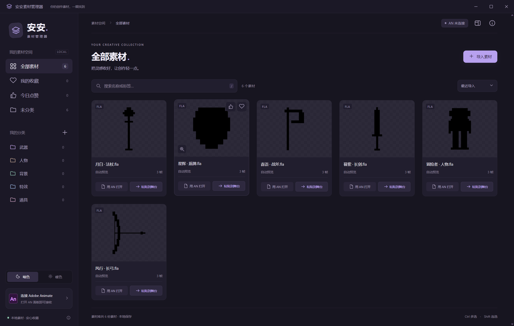
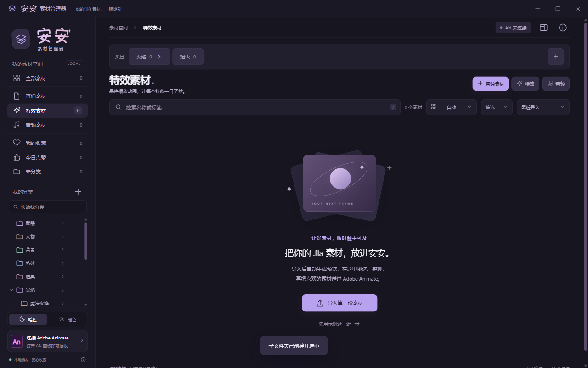
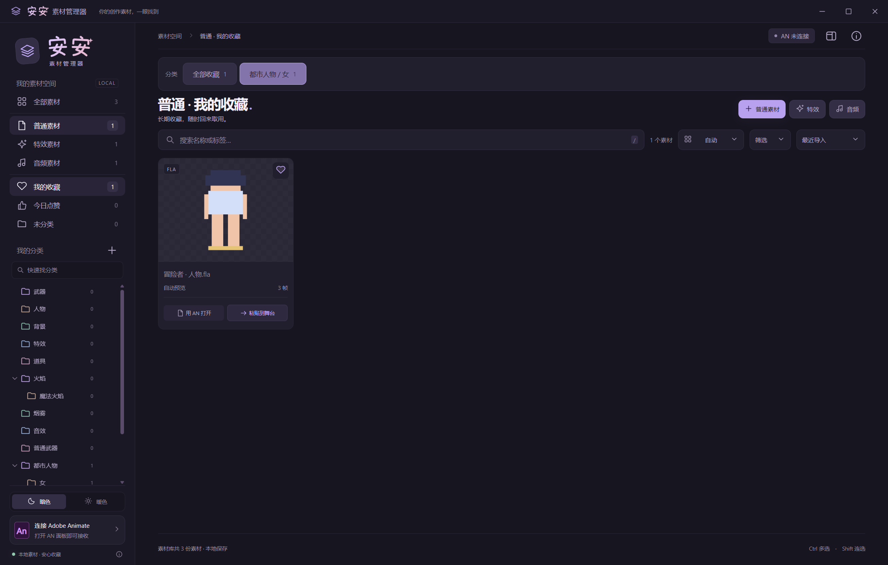
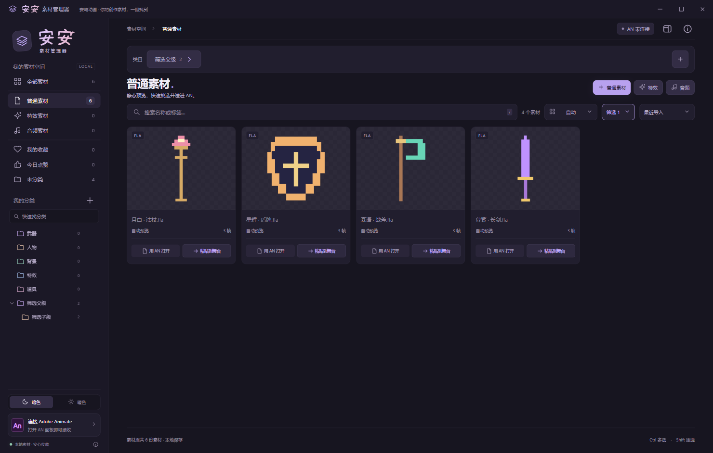

# 安安素材管理器 0.3.2

作者：安屿动画。项目采用 Apache License 2.0，并附带本项目的商业归属条款，详见 [LICENSE](LICENSE)、[NOTICE](NOTICE) 与 [COMMERCIAL-ATTRIBUTION.md](COMMERCIAL-ATTRIBUTION.md)。个人、学习和非商业创作可以免费使用，不要求额外页面署名；商业再发布或商业集成必须保留源代码归属，并在软件可见 UI 页面保留“安屿动画”署名。

> 这是一个面向 Adobe Animate 制作者的本地素材库：把分散的 FLA、预览图、GIF 和音频收进一个可搜索的空间，用预览图挑选素材，再把完整可编辑内容放到 AN 当前舞台。

## 目录

- [界面预览](#界面预览)
- [快速开始](#快速开始)
- [功能总览](#功能总览)
- [导入、预览与分类](#导入预览与分类)
- [发送到 Adobe Animate](#发送到-adobe-animate)
- [音频与特效](#音频与特效)
- [搜索、收藏与筛选](#搜索收藏与筛选)
- [安装与启动](#安装与启动)
- [开发、测试与发布](#开发测试与发布)
- [许可证与归属](#许可证与归属)

## 界面预览

### 素材网格



每张卡片都显示自动生成或复用的预览图，并提供「用 AN 打开」「粘贴到舞台」两个动作。右侧详情栏默认隐藏，给网格留出更多空间。

### 顶部子分类



左侧选择顶层素材类型后，顶部显示当前路径的直接子分类；点击后会继续进入更深一层，路径和按钮不会重复占用侧栏空间。

### 收藏分类



收藏会沿用素材原来的分类路径，例如「都市人物 / 女」。点赞保持单一列表，不额外复制分类树。

### 隐藏子分类筛选



在一个分类中打开「筛选 → 隐藏已归入子文件夹」，即可只看直接归入当前文件夹的素材；类型根目录会只保留未分类素材。

## 快速开始

1. 启动 `安安素材管理器 0.3.2.exe`，或运行安装版创建的桌面快捷方式。
2. 点击「普通素材」「特效」或「音频」，选择文件或文件夹。普通素材适合人物、武器、背景等 FLA；特效入口用于需要 GIF 预览的 FLA；音频入口用于 MP3、WAV、OGG、FLAC。
3. 在导入对话框选择已有分类，或直接创建顶级文件夹；选中已有分类后还可以创建子文件夹。确认后等待预览完成。
4. 用搜索、分类、收藏或顶部筛选找到素材。点击预览图可以放大，卡片底部可打开 AN 或发送到 AN 面板。
5. 在 Adobe Animate 打开目标文档和「安安素材管理器」面板，点击面板中的「粘贴到舞台」。素材会进入当前图层、当前播放头位置，并大致放在舞台中央。

## 功能总览

| 模块 | 能做什么 |
| --- | --- |
| 普通素材 | 导入 FLA、复用同名预览图、自动生成静态预览、搜索和分类 |
| 特效素材 | 导入 FLA、复用同名 GIF、自动生成受预算限制的 GIF 预览、悬停播放 |
| 音频库 | 导入 MP3/WAV/OGG/FLAC、试听、进度跳转、搜索、分类、定位原文件和拖出 |
| 分类 | 顶层文件夹、子文件夹、顶部逐层按钮、置顶、折叠、移动和撤销 |
| 个人整理 | 永久收藏、24 小时点赞、收藏按原路径分类、隐藏子分类筛选 |
| AN 联动 | 打开独立工作副本、发送完整 FLA、当前图层/帧插入、跨窗口拖拽 |
| 界面 | 暗色/暖色、每行自动/4/5/6 列、预览灯箱、滚轮缩放、紧凑小窗 |

为 Adobe Animate 制作的 Windows 本地素材管理器。一个 FLA 就是一份素材：导入、生成缩略图、搜索与归类，选中后发送到 AN 面板，再插入当前作品。

0.3.2 在 0.3.1 的基础上加入紧凑单按钮面板、按当前路径逐层显示子类目、可点击路径和圆角类目按钮、256/512/1024/2048（2K）预览分辨率选择，以及拖拽期间悬停 AN 任务栏图标的安全切换。用户已确认普通跨窗口拖到 AN 舞台可以完成粘贴；任务栏自动切换仍以独立手动验收为准。

这是 Windows 本地测试版。已在本机 Animate 2023（23.0.0.407 / CEP 11.5.3）验证真实素材插入、居中、当前帧生成普通关键帧、原图层保留及相同素材复用。复杂音频、相机、骨骼、脚本与 Animate 2024 宿主尚未完成实测。

## 启动

推荐双击便携版 `安安素材管理器 0.3.2.exe`。也可运行 `安安素材管理器 Setup 0.3.2.exe` 安装版；均不需要安装 Node.js。开发源码启动方法在下文。

此本地测试版没有代码签名。便携版解压到临时目录运行；素材库仍保存在 AppData，退出后不会丢失。面板清单支持 Animate 2023/2024（CEP 11/12），2023 已实测。

## 导入与预览

1. 顶部三个入口分别为「普通素材」「特效素材」「音频」。人物、武器等用普通素材；需要动图的FLA用特效素材；音频入口支持MP3、WAV、OGG、FLAC。选择文件或文件夹后递归扫描该类型，其他文件不导入。
2. 「优先使用同名预览图」默认勾选。例如 `长剑.fla` 同目录的 `长剑.png` 会直接使用。支持 PNG、JPG、JPEG、WebP，名称与扩展名不区分大小写；有多个候选时依此顺序选择。
3. 取消勾选会重新生成预览；没有同名图片或图片损坏时自动渲染。预览处理逐个进行，某个文件失败不会阻止其余素材。
4. 点击预览图放大查看，鼠标滚轮放大/缩小（25%至800%），拖动平移，按「重置」或0恢复。点击卡片名称区域选择。右侧详情默认隐藏，按「详情」展开后编辑名称、标签、分类或重试预览。

导入对话框还可以直接管理归类：选择已有分类作为导入目标；点「新建文件夹」创建顶级分类；选中一个已有分类后点「新建子文件夹」即可在它下面创建子分类。新建完成会自动选中，导入的素材会写入该分类的元数据，原文件位置和字节不变。未选择目标时，新素材保持未分类，重复素材保留原分类；显式选择目标时，重复素材也会归入目标分类。

导入对话框可勾选“自定义预览分辨率”，选择 256、512、1024 或 2048（2K）像素作为自动生成预览的最长边上限。它不会强行放大更小的源图；同名预览图启用复用时仍直接使用原图。高分辨率特效会自动控制帧数和总像素，超时会保留静态封面。

特效优先使用同名GIF，其次静态图；没有同名图时自动生成动态预览。默认GIF最长6秒、最多60帧、最长边640px；选用2K时仍保持2048最长边上限，并按总像素预算减少采样帧数。大于32MB的特效FLA只自动生成静态预览；处理超时保留已生成的静态图并提示。普通素材只生成静态图，不触发动图编码；分类移动也不会触发。误用特效入口时，用普通入口重新导入同一文件可改回普通素材，重复内容仍折叠。卡片悬停播放GIF，移开停止，放大预览中持续播放。

左侧「音频素材」是独立音频库，支持搜索、分类、收藏、点赞。点击「试听」显示底部播放器，可暂停、跳转进度，一次只播放一份；列表更新不打断试听。无法解码的音频会显示错误，仍能打开所在位置或拖出原音频库副本。

卡片底部「用 AN 打开」通过系统 FLA 关联打开独立工作副本，保存在库目录的 `opened` 文件夹，避免在 AN 中保存时改坏库里的原素材；想继续制作可在 AN 中另存为自己的文件。「粘贴到舞台」发送到 AN 接收面板。顶部暗色/暖色按钮切换并记住偏好，标题栏与主题一致。

所有素材和缩略图只在本机处理。自动预览不要求启动 AN。原始 FLA 与原始预览图不会被移动或修改，管理器保存自己的副本。

自动缩略图使用离线 FLA 解析器寻找非空画面，裁切透明空白。不是每一种 FLA 都能精确还原：旧版二进制文件、复杂滤镜、摄像机、脚本驱动内容、音视频、缺失字体可能预览失败或与 AN 不同。预览仅用于挑选素材，插入使用完整 FLA。自动渲染的单文件大小上限为 128 MB、超时为 45 秒；已有预览图上限为 50 MB。仅在元件库中有内容而舞台为空的文件会提示使用同名预览图。

## 搜索与快速归类

搜索素材名称或标签。左侧切换全部、我的收藏、今日点赞、未分类及自定义分类。收藏长期保留；点赞从点击起保留 24 小时，到期仅退出点赞视图，不删除素材。关闭软件后也继续计时。顶部「筛选」菜单提供「隐藏已归入子文件夹」：浏览一个分类时只显示直接归入该分类的素材，隐藏其子分类和更深层子分类；普通、特效、音频三个类型根只显示未分类素材。全部素材、收藏和今日点赞视图不受此开关影响。

进入「我的收藏」后，顶部会按收藏素材原本的分类路径自动生成分类按钮，例如「都市人物 / 女」「背景 / 室内」；点击按钮只筛选该原分类下的收藏，不复制或维护另一套收藏分类。没有原分类的收藏归入「未分类」。今日点赞保持单一列表，不显示这组收藏分类。

分类支持子分类，例如「人物→男／女」。分类管理中选父级或新建子分类，父类包含后代素材。删除分类会保留素材并提升子分类，直接归入该类的素材变未分类，可撤销。单击卡片名称区域选择，Ctrl 多选，Shift 连选，Ctrl+A 选中当前页。每页最多60份；搜索、分类和排序覆盖整个素材库，翻页清除当前选择。

分类树独立滚动，不挤出底部主题和连接按钮。使用分类搜索快速定位，箭头折叠子分类，展开状态本机记忆；分类旁的置顶按钮将它排到同级前面，再点取消。置顶写入素材库，重开保留，并支持撤销。在音频/普通/特效视图里选分类或收藏仍保留该类型筛选。

左侧选择「普通素材」「特效素材」或「音频素材」后，顶部类目栏显示当前路径的下一层文件夹，并使用与「普通素材」入口一致的圆角按钮样式；每层只保留一个最右侧的「＋」按钮用于新建子类目。比如普通素材下有「背景」「表情素材」「都市人物」，点击「都市人物」后按钮会切换为「男」「女」，点击「背景」后切换为「室内」「户外」。顶部路径显示为「素材空间 > 普通素材 > 都市人物」，每一段都可以点击返回；不会把文件夹路径图标重复塞进按钮。新建子类目会沿用父类目的类型范围。

选中素材后按「选择分类」，再点分类即可批量归类；归类按钮按需展开。详情也可修改分类。改变的是库元数据，不移动原文件。「撤销」恢复上次修改，最近 50 次操作保存在本地。

点击右上小窗按钮进入紧凑置顶模式，方便与 AN 并排使用。点击其他程序、最大化、全屏或最小化时会取消置顶，离开小窗后恢复原来的窗口大小。

搜索旁的显示菜单可选择自动、每行 4、5 或 6 个素材，软件会记住设置。窗口变窄或展开详情时，会减少实际列数以保持卡片按钮可用。顶部操作区已压紧，给素材更多显示空间。

左上角“安安”为项目原创矢量字标，暗色与暖色主题分别使用淡紫粉色和棕杏色渐变；不依赖外部字体或字体安装。

素材名称旁的文件夹按钮可「打开文件所在位置」，在资源管理器选中原始 FLA，方便找回同目录的文件。原始位置已不可用时会定位素材库副本并提示；这个操作不会修改素材。

## 插入当前 AN 文档

从软件的「连接 Adobe Animate」中打开 AN 面板文件夹，按照其中 `README.md` 和安装脚本说明安装。交付的 CEP 面板已本机自签，安装会保留完整签名文件，默认无需开启未签名扩展调试；桌面 EXE 仍是无商业代码签名的本地测试版。

1. 在 AN 中打开正在制作的目标文档与「安安素材管理器」面板。
2. 在管理器点击素材卡片「粘贴到舞台」。
3. 回到 AN 面板，点击「粘贴到舞台」。

AN 面板只保留一个按钮，默认内容区约 48×48、最低 40×40；窄面板用图标表示状态，放大后显示文字。素材名称、连接状态和详细结果可悬停查看。更新面板后，AN 可能保留之前的大窗口尺寸，拖动边缘缩小即可；新的菜单名称在下次重启 AN 后生效，请先保存自己的作品。

若旧版面板只有标题而内容完全空白，请使用完整的新版面板目录重新安装，再关闭并重新打开该面板。本机的未签名插件曾在 CEP 签名检查阶段被拒绝，即使开发调试设置正确也未加载按钮；签名修复已在真实 AN 2023 确认按钮出现和管理器连接恢复。不要修改已签名的 HTML/JS 或遗漏 `mimetype`、`META-INF` 文件。

完整素材组织为可编辑元件，保留源场景图层和帧；多个场景依次排列。插入目标当前图层、播放头准确所在帧，大致放到舞台中央。如果该帧尚未打关键帧，生成普通关键帧并继承原内容后追加；已有关键帧直接追加。不新增目标层、不打空白关键帧。元件内部编辑时返回当前场景舞台。锁定或不可写目标层会拒绝。

不会自动保存目标作品。插件临时打开独立源副本完成复制并关闭，最终保留当前目标文档。首次使用建议用目标作品副本核对层、帧、嵌套动画和画面。

重复导入字节完全一致的 FLA 在素材库中折叠为一份；同一个 FLA 多次插入 AN 时复用现有元件。不同内容的文件使用各自命名空间，避免同名元件覆盖。不同 FLA 之间恰好同名的元件不会仅凭名称合并。帧率不同会提示，脚本、链接标识与多场景动画的运行行为需要真实 AN 验证。

如果在 AN 内修改了已经插入的 `whole` 元件，后续重复插入会使用该修改后的元件。插件一次插入的 FLA 上限为 512 MB；过大的素材不会读入插件内存。

AN 未连接时依然可管理素材，发送会保留待处理请求。当前只保留最后一次发送的素材，请完成一次插入后再发送下一份。

卡片「拖出」区域：FLA拖到AN舞台／工作区松开，接收面板自动执行插入。请先打开目标作品与新版安安面板，并把管理器与AN并排摆放；Escape取消。也可以在同一次拖拽中悬停 Windows 任务栏的 AN 图标，管理器会先确认任务栏按钮和 Animate 进程，再由面板重新验证鼠标位置、能力和文档后切换前台。拖动时不把FLA或标记文件交给AN原生导入器，只在这一次手势期间启动只读位置监视器。释放位置和目标文档通过校验后，5秒内自动发送到当前文档、当前图层、播放头位置。文档切换、其他程序、错误目标或同时有多个AN进程会拒绝；可用原有「粘贴到舞台」按钮确认方式。旧面板会提示更新，请关闭并重新打开面板。音频仍可拖到剪映或AN支持导入的位置，发送的是库中音频副本；不移动原件。普通跨窗口拖到 AN 舞台已由用户实机确认可用，任务栏悬停切换仍需单独验收。

空闲同步仅传递变化令牌，窗口隐藏时降低检查频率；每页最多60张卡片控制图片和页面资源。性能记录使用CPU时间差和进程私有字节，内存口径与任务管理器不同，具体值随素材、动画播放和窗口状态变化。

## 数据与备份

数据位于 `%APPDATA%\AnShelf`，包含 `library.json`、素材副本 `assets`、预览缓存 `previews` 和插件通信 `bridge`。关闭管理器与 AN 后，复制整个文件夹即可备份；恢复时也在软件关闭后替换整个文件夹。

从库中移除素材只移除列表记录，原始文件保持不变；缓存副本保留以支持撤销。卸载程序不会主动删除素材库。预览失败可重试或重新导入同名图片；元数据损坏时先备份，不要清空原文件。

## 开发

需要 Node.js 22+、pnpm 和 Windows。安装依赖需要网络，运行产品无需网络。

```powershell
pnpm install --frozen-lockfile
pnpm test
pnpm build
pnpm start
pnpm run package
```

`pnpm run e2e` 需要可用的 Playwright；可通过 `ANSHELF_PLAYWRIGHT` 指定已安装的 Playwright 包路径。真实点击测试为 `node scripts/ui-e2e.cjs`。不要在同一时间用两个进程写入同一个数据目录；测试使用独立临时目录。

导入选项与打包产物测试：`node scripts/import-e2e.cjs`。设置 `ANSHELF_EXECUTABLE` 为 `安安素材管理器.exe` 即可验证该构建。它替换原生文件选择器返回值，真实点击验证同名图片、关闭选项后渲染、导入取消和插件文件夹。未配置 FLA 默认关联时可设置本机进程环境变量 `ANSHELF_ANIMATE_EXE` 为 Animate.exe 的绝对路径；程序不会修改默认关联。

模块、验收与验证记录见 `ARCH.md`、`PRD.md`、`TEST_PLAN.md`、`PROJECT_STATE.md`。引用和许可证见 `THIRD_PARTY_NOTICES.md`。

想参与开发请先阅读 [CONTRIBUTING.md](CONTRIBUTING.md)。发布前必须通过构建、自动测试、打包一致性检查，并由项目维护者确认后再上传公开仓库。

## 许可证与归属

项目代码以 Apache License 2.0 为基础，完整文本见 [LICENSE](LICENSE)。原作者归属见 [NOTICE](NOTICE)，商业再发布的额外归属约定见 [COMMERCIAL-ATTRIBUTION.md](COMMERCIAL-ATTRIBUTION.md)。

个人、学习、研究和非商业创作可以免费使用，不要求额外页面署名。商业版本请保留源代码归属头、NOTICE 和“安屿动画”UI 署名；可以把署名放在标题栏、关于页或设置页。第三方组件的许可证以 `THIRD_PARTY_NOTICES.md` 和 `vendor/licenses/` 为准。

这份商业归属文件是本项目的附加政策，不能替代 Apache-2.0 正文。用于商业合同、大规模分发或特定国家/地区时，请让熟悉适用法域的律师审核最终文本。
