# 安安素材管理器 0.3.10

0.3.10：确认后把素材复制成可独立编辑的新卡片；全部选择菜单统一主题，分类支持搜索和层级提示；AN「加入素材库」可在保存前选择普通／特效、分类及默认至 2K 预览。主程序与随附插件均为 0.3.10，旧用户需要在软件内更新插件并重新打开 AN 面板。详见 [0.3.10 更新说明](docs/releases/0.3.10.md)。

作者：安屿动画。一个面向 Adobe Animate 制作者的本地素材库：导入 FLA、GIF 和音频，自动准备预览，搜索分类后，把完整素材放进 AN 当前舞台。
[](LICENSE)

## 下载与更新：选对文件就能用

前往 [0.3.10 中文发布说明与下载页](https://github.com/anyv-DH/anshelf/releases/tag/v0.3.10)，或直接点击下面的中文入口。**安装版和免安装版选一个；需要 AN 舞台粘贴或「加入素材库」时，可在软件内直接安装随附插件。**

| 下载内容 | 适合谁、有什么用 | 安装或更新方式 |
| --- | --- | --- |
| [下载安装版 0.3.10（推荐）](https://github.com/anyv-DH/anshelf/releases/download/v0.3.10/AnAn-AssetManager-Setup-0.3.10.exe) | 长期使用，想要正常安装和桌面快捷方式 | 双击安装，按提示完成；旧用户先退出旧管理器 |
| [下载免安装版 0.3.10](https://github.com/anyv-DH/anshelf/releases/download/v0.3.10/AnAn-AssetManager-Portable-0.3.10.exe) | 不想安装，保存到固定文件夹后直接运行 | 双击即可打开；更新时退出旧版后运行这份新版文件 |
| [下载独立 AN 插件包（可选）](https://github.com/anyv-DH/anshelf/releases/download/v0.3.10/AnAn-AssetManager-AnimatePlugin.zip) | 需要手动安装或单独留存插件时使用 | 软件内已可一键安装；手动方式为完整解压后运行 `install.ps1` |
| [下载图文使用说明（可选）](https://github.com/anyv-DH/anshelf/releases/download/v0.3.10/AnAn-AssetManager-Usage.md) | 单独保存教程，了解导入、分类、预览和 AN 操作 | 也可以直接阅读本页，无需另外安装 |
| [下载文件校验信息（可选）](https://github.com/anyv-DH/anshelf/releases/download/v0.3.10/SHA256SUMS.txt) | 核对下载文件是否完整 | 不需要运行；普通安装可跳过 |

源代码压缩包用于开发，不是安装程序。发布页中的附件文件名保留统一命名，上表的中文链接与用途逐项对应。

**旧用户这样更新：**退出旧管理器 → 安装或打开 0.3.10，新版继续沿用原素材库与分类。本版 AN 插件也升级为 0.3.10；请打开「检查更新」或「连接 Adobe Animate」，点击「安装／更新 AN 插件」并确认，再关闭、重新打开 AN 中的「安安素材管理器」面板。必要时保存作品后自行重启 AN。只更新软件、未更新插件，不会显示新的入库选项。软件不会自动保存或关闭 AN。

从 **0.3.8 起**，启动约 3 秒后会进行一次轻量的 GitHub 版本检查，有新版时给出提醒；也可手动点击「检查更新」，或关闭自动检查。离线时照常管理素材，检查不会自动下载或安装更新，也不会在关闭软件后留下常驻检查进程。**0.3.7 及更早版本没有这项提醒功能，需要先从上表手动更新一次。**

从 **0.3.9 起**，更新窗口还支持手动下载对应的安装版／免安装版，显示进度并核对文件大小与 SHA256；完成后由您再次确认。安装版点击「退出并更新」进入安装向导；免安装版点击「退出并打开新版」，从 `%APPDATA%\AnShelfUpdates` 的持久目录启动新版，不覆盖旧程序或旧快捷方式，可先「打开文件位置」找到新版，再更新自己的入口。素材库仍位于 `%APPDATA%\AnShelf`。

想换个喜欢的背景？点击左侧「更换皮肤」，选择本机图片、GIF 或视频，调节遮罩深浅即可。只引用原文件，不复制媒体；动态底图可暂停，窗口切到后台时暂停播放。素材卡片保持不透明，方便看清素材。详见下方「自定义底图皮肤」。

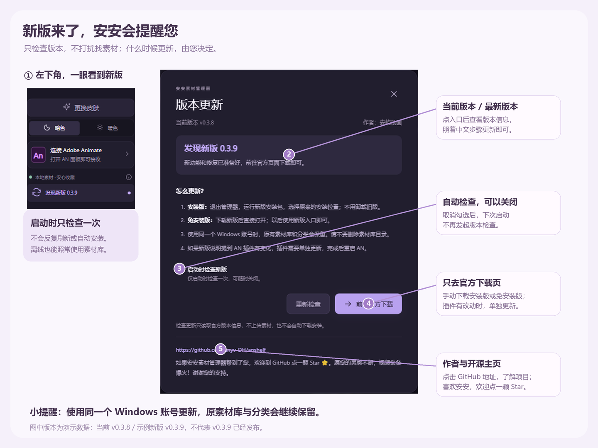

图中版本仅为演示。左下角出现新版提示时，点击即可查看中文更新步骤；取消勾选「启动时检查新版」可关闭自动检查，仍能手动检查。0.3.9 增加了插件安装与主程序下载控件，以实际窗口为准。

## 先看图：从导入到粘贴
下面按实际使用顺序排列。图片中的粉色圆点、箭头和标签就是操作位置；照着编号点即可。
### 1. 素材总览
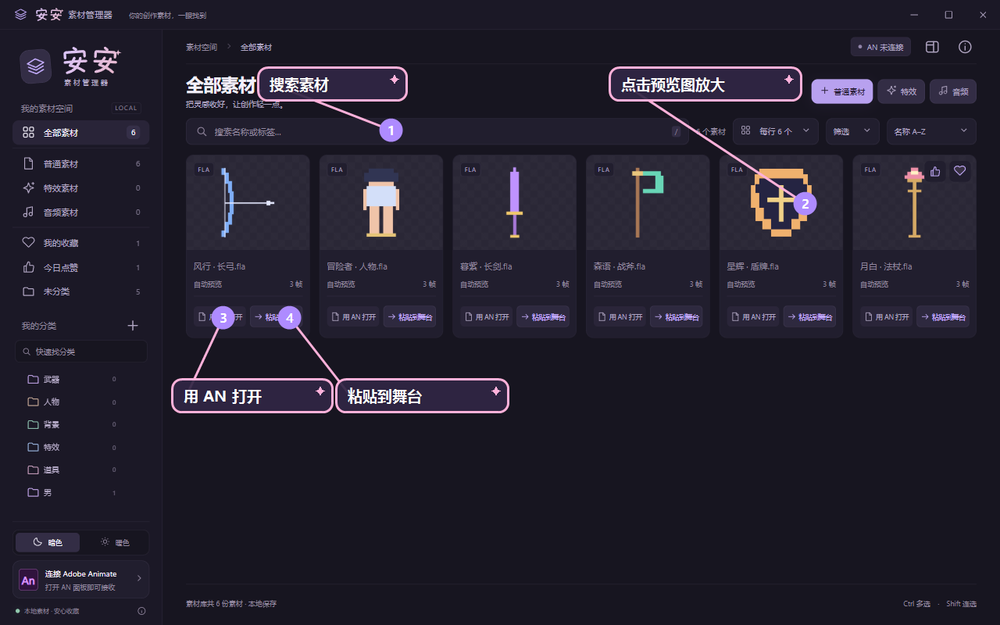
搜索框找素材；卡片底部可「用 AN 打开」或「粘贴到舞台」；右侧详情栏默认收起，网格空间更大。
### 2. 导入普通素材，并选择 2K 预览
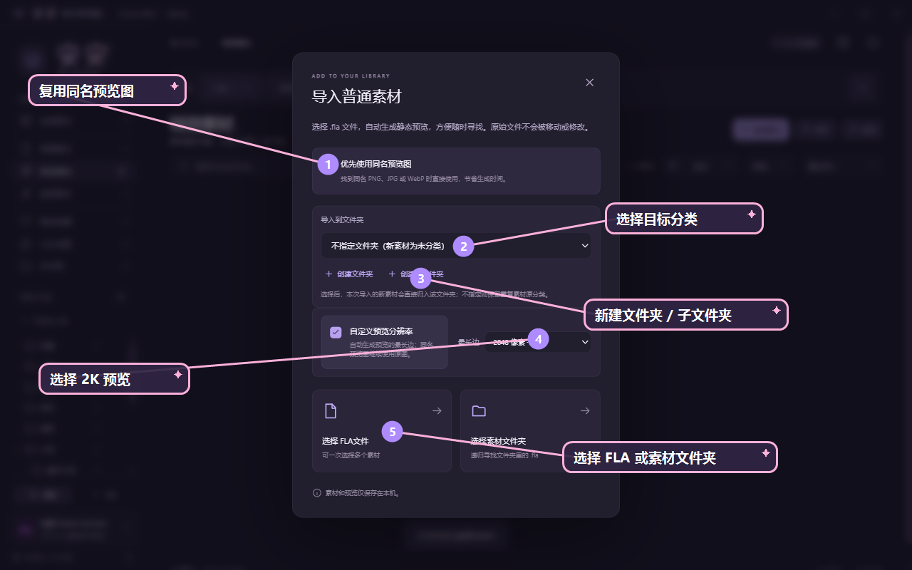
可以复用同名 PNG/JPG/WebP，也可以让管理器自动生成 256、512、1024 或 2048（2K）预览；导入时还能创建文件夹或子文件夹。0.3.10 的分类选择器可搜索分类名和完整路径，按层级展示；上图为导入流程示意，以新版主题选择器为准。
### 3. 从顶层分类进入更深的子分类
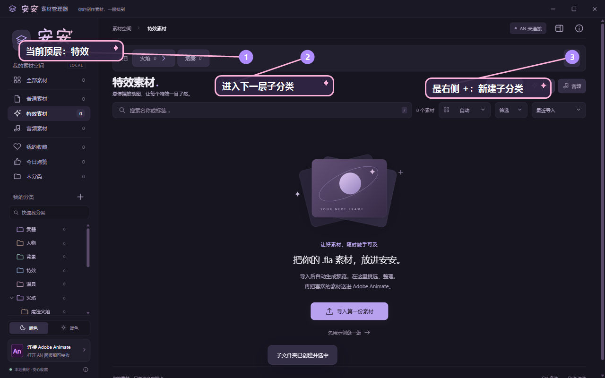
左侧先选顶层类型，例如「特效」；顶部再显示当前路径的下一层按钮。进入「都市人物」后，还能继续显示「男／女」等更深一级。
### 4. 只看当前文件夹直接归入的素材
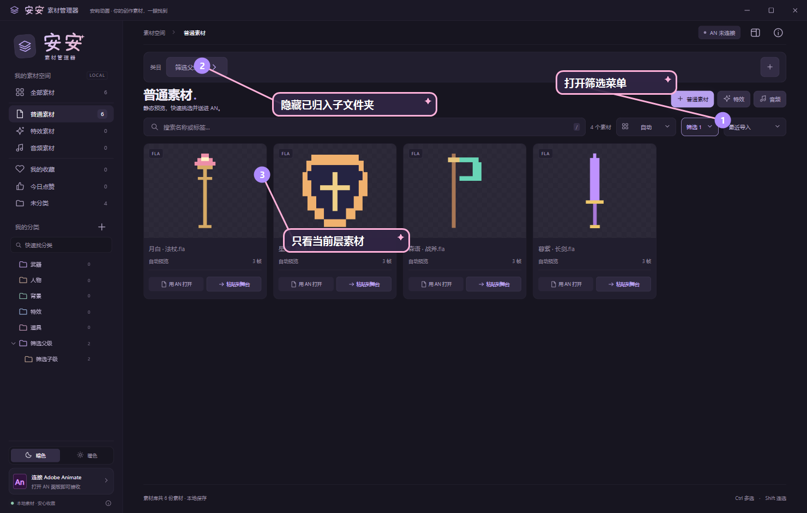
打开「筛选 → 隐藏已归入子文件夹」，快速整理当前层级，避免父文件夹和子文件夹的素材混在一起。
### 5. 收藏按原路径自动分组
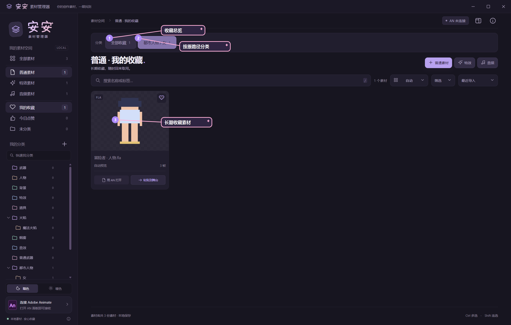
收藏长期保留，并沿用原来的分类路径；「今日点赞」只保留 24 小时，不建立额外分类树。
### 6. 点预览图放大，滚轮缩放
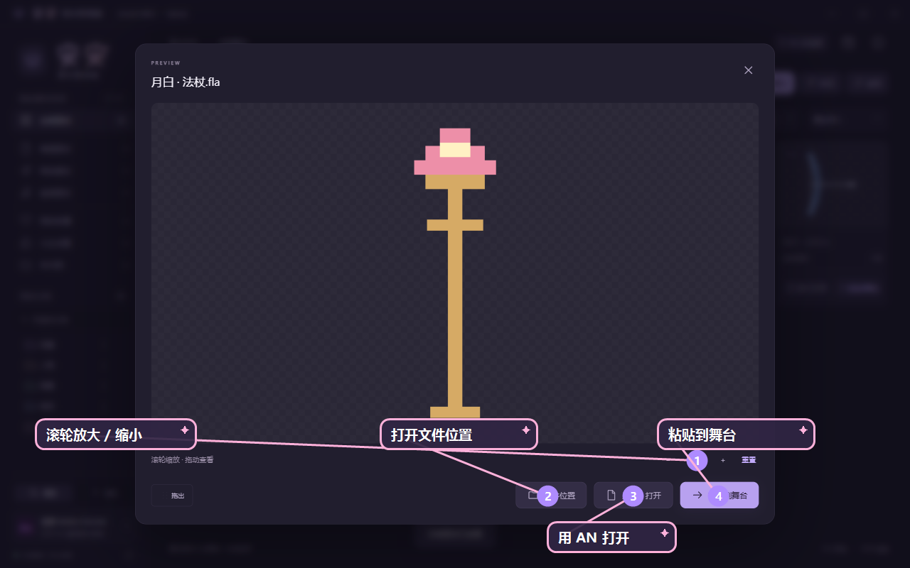
点任意预览图打开灯箱；鼠标滚轮缩放，拖动查看，底部可以打开文件位置、用 AN 打开或粘贴到舞台。
### 7. 特效素材单独导入并查看动图
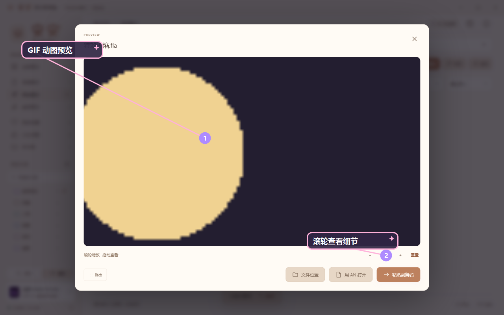
特效入口和普通素材分开，优先使用同名 GIF；没有 GIF 时自动生成受预算限制的动图预览，避免导入大文件时卡住普通素材库。
### 8. 音频库：试听、分类、拖出
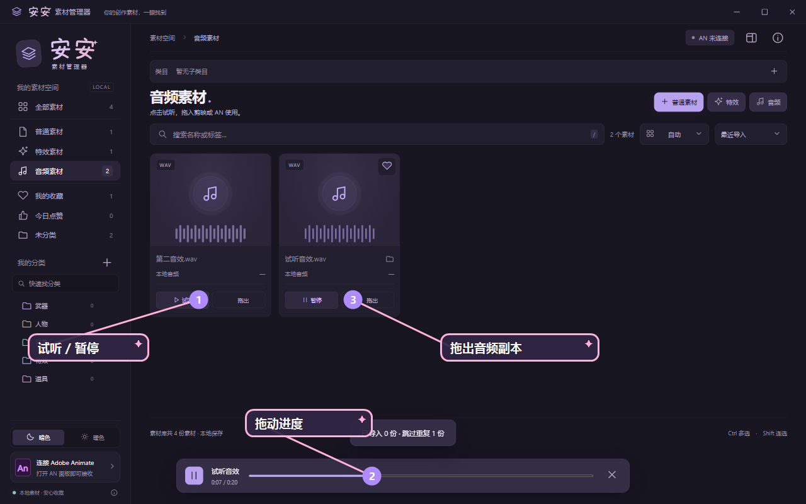
音频入口支持 MP3、WAV、OGG、FLAC；可以试听、搜索、收藏、分类，也可以拖出音频副本到支持导入的应用。
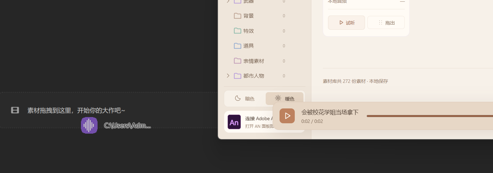
卡片按住「拖出」即可把音频副本拖到剪映等软件，原音频库文件不会被移动；底部播放器可以暂停和拖动进度。
### 9. 发送到 AN 当前舞台
打开目标 AN 文档和「安安素材管理器」面板：在管理器点击「粘贴到舞台」，再在 AN 面板点击同名按钮。素材会进入当前图层、当前播放头位置；没有关键帧时会在当前位置生成普通关键帧，不新建图层。
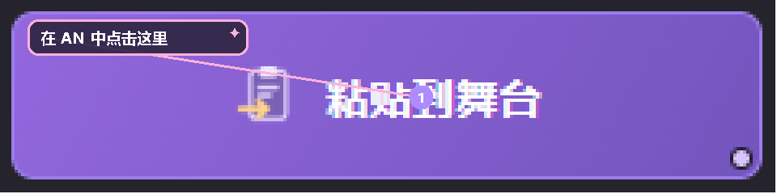
也支持把卡片拖到 AN 舞台；拖动到任务栏 AN 图标时，管理器会先切换窗口，再由面板确认目标文档。
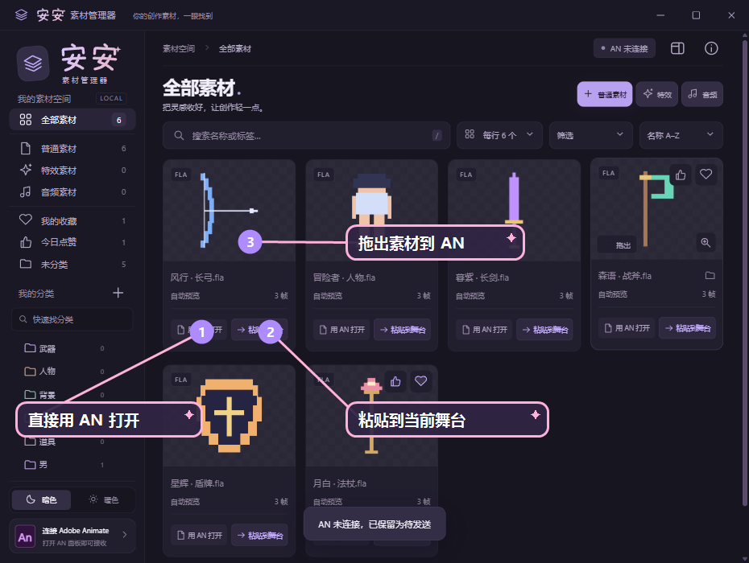
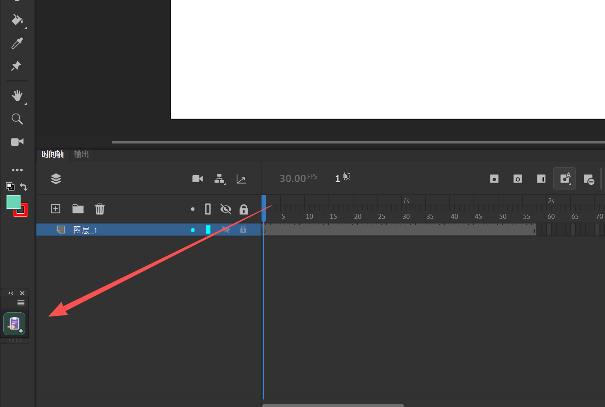
面板可以缩成侧边的窄栏，不挡舞台。0.3.10 延续上下两个小图标：上面粘贴到舞台，下面将当前文档加入素材库。下图仅示意图标布局，新增的入库设置见后面的操作步骤。


### 10. 小窗和显示密度
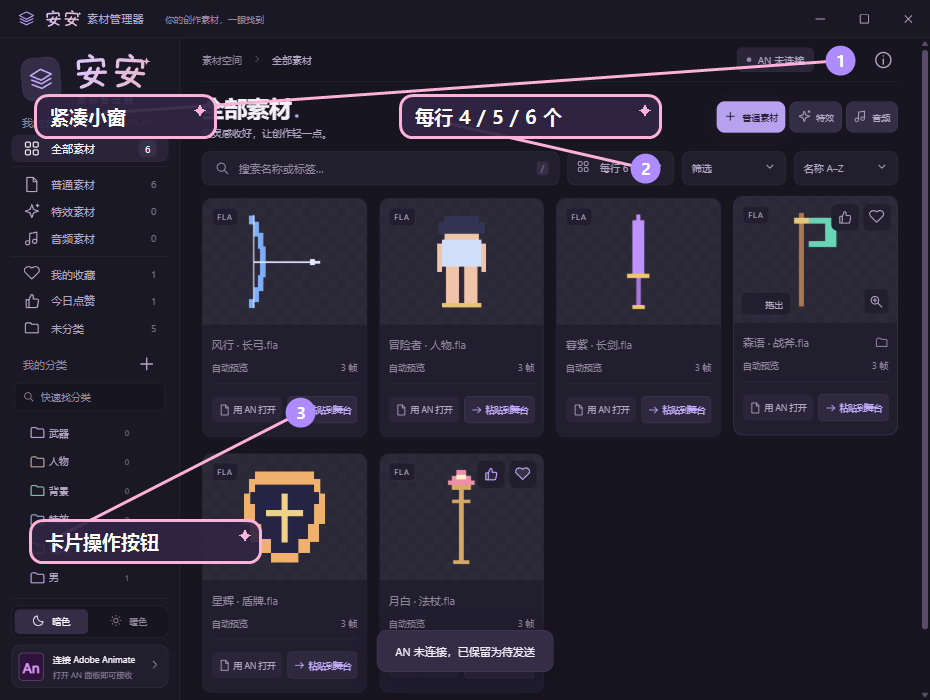
右上角小窗按钮用于和 AN 并排；显示菜单可选自动、每行 4、5 或 6 个素材。
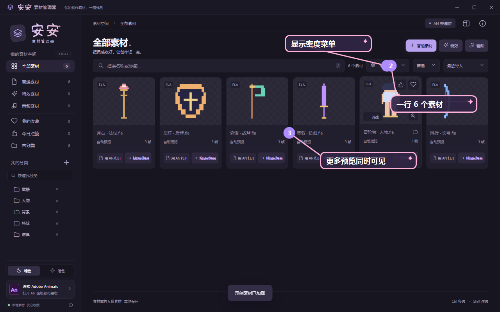
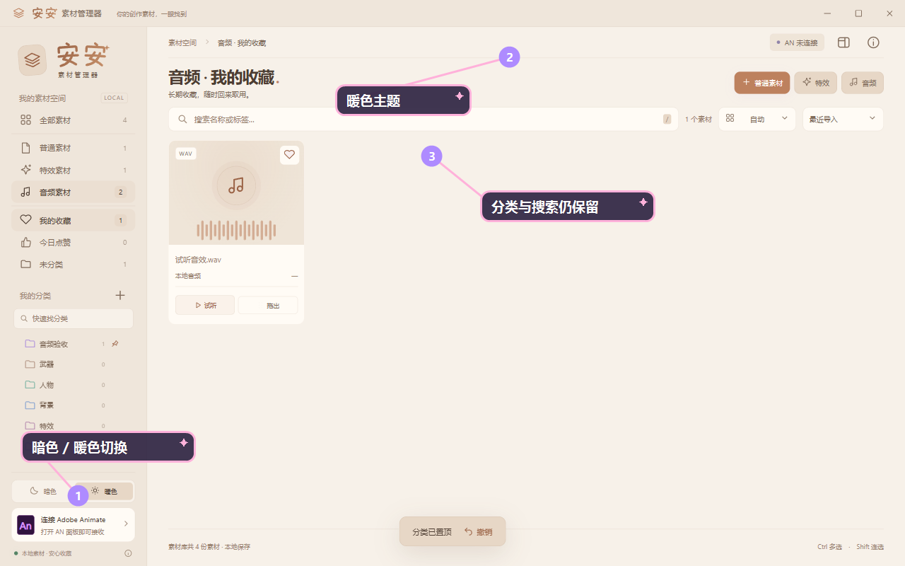
左下角可在暗色与暖色之间切换，偏好会自动记住。

## 功能亮点：它能替你省下什么

### 1. 先看预览图，再决定用哪个文件

- 导入 FLA 后自动生成静态预览；目录里已有同名 PNG、JPG、JPEG 或 WebP 时可以直接复用，不需要手动一张张截图。
- 预览最长边可选 256、512、1024 或 2048（2K）；小图不会被强行放大，原始 FLA 也不会被改写。
- 点击预览图进入灯箱，滚轮放大、拖动查看细节；还能一键打开原文件位置、用 AN 打开或粘贴到舞台。原文件找回不需要再翻文件夹。
- 搜索名称和标签即可快速定位；重复导入同一份内容会折叠成一条，素材库不会越导越乱。

### 2. 分类可以从少量文件一直长到大型素材库

- 普通素材、特效和音频各有独立入口；左侧管理顶层类别，顶部按钮显示当前路径的下一层，例如「都市人物 → 男／女」。
- 导入时可以直接选择已有文件夹，也可以创建顶级文件夹或子文件夹；新分类会立即成为导入目标。
- 主程序五处选择菜单全部跟随暗色／暖色主题：导入分类、预览分辨率、上级分类、素材类型、详情中的移动分类。三处分类菜单可搜索分类名和完整父路径，分层显示同名子分类；分辨率与素材类型使用紧凑菜单，选项少时不用再找搜索框。
- 分类支持置顶、折叠、搜索、批量移动和撤销；「隐藏已归入子文件夹」可以只看当前层，整理时不会被下层素材干扰。
- 同一个人物可以加入多部剧的分类：选中素材，点击「加入其他分类」，保留原来的归属；多个分类共享一份素材与预览，不复制出重复卡片。需要迁移时继续使用「选择分类」。
- 在某个真实分类中点「从当前分类移除」，只取消该分类及其子分类内的归属，其他分类仍保留；没有其他归属的素材进入「未分类」。要从全部分类、收藏和点赞中移除记录，请明确选择独立的「从素材库移除」，两种操作都有主题确认且可撤销。
- 收藏会按素材原来的分类路径自动生成分类按钮；点赞只保留 24 小时，适合临时收集当天要用的素材。

**分类怎么选：**点击文件夹选择框，输入分类名或父级路径，选择结果即可；例如输入「都市 主角」，可直接定位「都市人物 / 女 / 主角」。下面是隔离演示库的菜单局部。

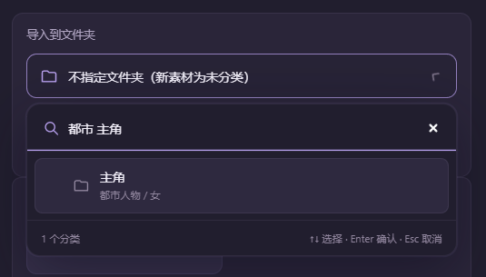

**分辨率怎么选：**先勾选「自定义预览分辨率」，再点击「最长边」选择 256、512、1024 或 2048（2K）。取消勾选后，分辨率菜单同步禁用并恢复默认生成方式；已有同名预览图仍可直接复用。

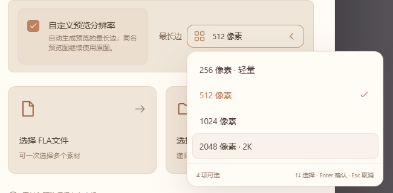

[查看完整暗色菜单](docs/images/select-resolution-dark-0310.png) · [完整暖色菜单](docs/images/select-resolution-warm-0310.png) · [完整分类搜索](docs/images/category-search-0310.png)

### 3. 普通素材、特效和音频各走适合自己的流程

- **普通素材**：适合人物、武器、背景等 FLA，优先使用已有预览，缺少预览时再生成静态图。
- **特效素材**：单独处理 GIF；优先复用同名 GIF，没有 GIF 才生成动图，并控制帧数、时长和像素预算，避免大特效拖慢普通素材库。
- **音频库**：支持 MP3、WAV、OGG、FLAC；卡片可以试听、暂停、拖动进度、收藏、分类，也能把音频副本直接拖到剪映等软件。

### 4. 选中的内容直接进入当前 AN 作品

- 「用 AN 打开」直接打开素材库内该素材唯一的 FLA 文件，不额外创建工作副本。AN 保存后，下次打开或粘贴时会自动识别修改、更新素材记录并重新生成预览；最初导入位置的外部原文件保持不变。
- 「粘贴到舞台」发送完整可编辑 FLA；在 AN 中点击面板按钮后，素材进入当前图层、当前播放头位置，大致位于舞台中央。
- 当前帧没有关键帧时，会在指针所在位置生成普通关键帧并保留当前内容；不会新建图层，也不会插入空白关键帧。
- 同一份素材有三种进入 AN 的方式：点击卡片「粘贴到舞台」的磁力式流程、把卡片拖到 AN 舞台、拖动时悬停任务栏 AN 图标后再释放；面板保留紧凑图标按钮，适合缩成侧边栏小面板。舞台粘贴直接读取库内 FLA，不写入临时副本；如果这份素材正开在 AN 里，先关闭它再粘贴，防止影响正在编辑的文档。普通跨窗口舞台拖拽已有用户实测；任务栏切换与 0.3.10 新面板的最终宿主流程仍需独立实测，自动化测试不代表所有 AN 素材兼容。

### 5. 界面跟着工作习惯走

- 右侧详情默认收起，把空间留给预览图；需要改名称、标签或分类时再展开。
- 暗色和暖色两套主题、自动或每行 4／5／6 个卡片、紧凑小窗和置顶模式，适合和 AN 并排工作。
- 卡片底部动作固定，鼠标悬停时才显示拖出、收藏、点赞和打开文件位置等辅助按钮，减少误点；临时要用的素材点一次点赞，24 小时内都能从「今日点赞」快速找回。

### 6. 本地优先，素材可控

- FLA、预览图、音频和索引默认只在本机处理，不要求上传素材到云端；原始文件位置和字节保持不变。
- 关闭管理器和 AN 后复制 `%APPDATA%\\AnShelf` 即可备份整个库；卸载软件不会主动删除素材库。
- 项目免费开源，代码采用 Apache-2.0；商业再发布按项目附加归属政策保留「安屿动画」归属，具体以 [NOTICE](NOTICE) 和 [COMMERCIAL-ATTRIBUTION.md](COMMERCIAL-ATTRIBUTION.md) 为准。

## 快速开始
### 安装版（推荐）
1. 打开 [最新版发布页](https://github.com/anyv-DH/anshelf/releases/latest)，下载 `AnAn-AssetManager-Setup-0.3.10.exe`。
2. 双击安装包，选择安装位置并完成安装；安装程序会创建桌面快捷方式。
3. 从桌面快捷方式启动软件。卸载软件不会主动删除 `%APPDATA%\\AnShelf` 素材库。

### 便携版
下载 `AnAn-AssetManager-Portable-0.3.10.exe` 后直接双击即可运行，不需要安装 Node.js，也不需要管理员权限。建议保存到固定文件夹；移动程序不会移动素材库。更新时先退出旧版，再打开新版，已有素材库继续使用。在软件内下载的新版位于 `%APPDATA%\AnShelfUpdates`，可定位文件并为它重新建立快捷方式；旧快捷方式仍打开旧程序。

### 第一次连接 Animate
在管理器打开「检查更新」或「连接 Adobe Animate」，查看「软件附带」和「已安装」的插件版本，点击「安装／更新 AN 插件」并确认。插件已经随主程序附带，不需要另行下载，也不需要输入命令；安装前会校验签名清单，旧插件保留可恢复备份。安装后关闭再打开 AN 中的「安安素材管理器」面板；必要时保存作品后重启 AN。在「窗口 → 扩展 → 安安素材管理器」打开面板，并保持管理器运行。软件不会自动保存或关闭 AN。

如果需要手动安装，仍可下载上表的独立插件包，完整解压后运行其中的 `install.ps1`。签名为项目本地自签，不代表 Adobe 审核。详细步骤见插件目录的 `README.md`。

### 复制新文件与 AN 当前文档入库

#### 做一个可以单独修改的素材变体

1. 悬停素材卡片，点击名称旁的双页图标「复制并加入素材库」；也可在放大预览或详情中点击「复制并入库」。
2. 阅读确认窗口，再点击「确认复制并入库」。取消、Esc 或关闭确认窗口都不会创建文件，也不会修改索引、预览和已有素材。
3. 新卡片会自动出现并被选中，资源管理器同时定位新文件。名称按「素材名 - 副本」「素材名 - 副本 (2)」递增，不覆盖原文件。
4. 以后分别用 AN 打开原素材和副本，即可制作不同版本。副本继承类型、全部分类、标签与预览设置，不继承收藏和点赞。

这项明确确认的操作只新增一个库内 FLA／音频文件，并登记为独立素材；预览使用独立的小型缓存。不会再先向外部原文件夹复制后又重复导入，也不需要手动重新入库。普通重复导入仍按内容去重，主动创建的独立副本不会因为初始字节相同而与原素材合并。普通打开、编辑、分类和舞台粘贴继续使用各素材自己的唯一管理文件。

#### 从 AN 把当前作品加入素材库

1. 保持安安素材管理器运行，更新到随附 **0.3.10 插件**，再重新打开 AN 面板。
2. 在 AN 小面板下方点击加号「加入素材库」，核对将要保存的当前文档。
3. 在确认窗口选择「普通素材」或「特效素材」；搜索并选择兼容的分类文件夹，也可不指定分类。已有素材保留其他分类归属。AN 中的分类和分辨率也使用紫色主题菜单，不再弹出系统样式的原生选择列表。
4. 预览分辨率可选「默认」、256、512、1024、2048（2K），并可勾选「优先使用已有的同名预览图」。这些选项只影响素材库与生成的预览，不会改写作品尺寸。
5. 点击「保存并加入」后才保存并入库。未命名文档会先出现 AN 自带保存窗口；取消保存则不入库。入库后回到管理器选材即可。

库内文档更新原记录与预览；外部新文档通过正常导入机制创建一份管理文件。旧插件或未携带设置的请求继续沿用默认行为：新素材按普通素材处理，已有素材的类型、分类和预览设置不被无意清空。确认期间切换文档会停止操作，避免保存错文件。

面板仍保持约 48×88、最低 40×80 的两枚竖排按钮。窄浮动面板会尝试临时展开显示设置，完成后恢复；**停靠面板受 AN 限制而无法展开时，仍使用旧版原生保存／入库确认和默认方式，不会在原生确认框里展示上述新选项**。需要完整设置时，可将面板暂时拉出为浮窗，或回管理器导入。外层标题和实际停靠尺寸由 AN 控制。

下面展示 0.3.10 的入库设置与分辨率主题菜单。截图来自隔离演示，当前版本的完整实际 AN 宿主流程仍需独立验证。

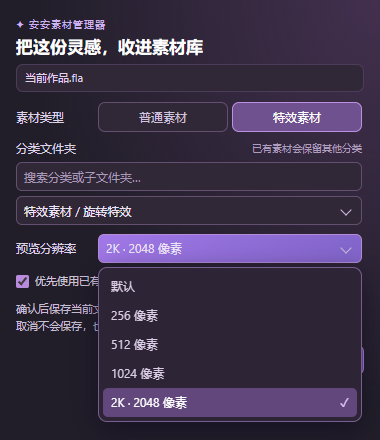

### 自定义底图皮肤

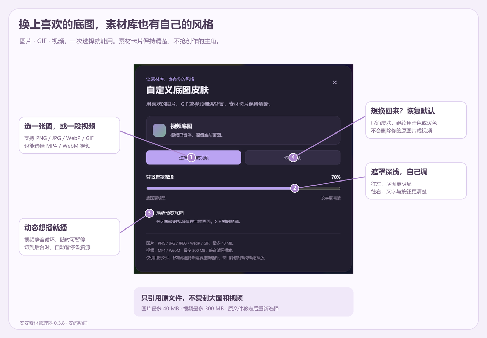

点击左侧「更换皮肤」→「选择图片或视频」，可选择 PNG、JPG、JPEG、WebP、GIF（最多 40 MB）或 MP4、WebM（最多 300 MB）。背景以铺满方式展示，滑动「背景遮罩深浅」调整图片明显程度与文字可读性。

- 视频静音循环，GIF 支持动画；关闭「播放动态底图」可暂停。视频保留当前画面，GIF 暂时隐藏。
- 切到其他程序或最小化窗口时暂停动态底图；回到管理器后按原播放设置恢复。系统开启减少动态效果时默认暂停，可自行开启。
- 设置只记录原文件位置与少量选项，不复制图片或视频。移动、删除原文件或解码失败时恢复默认显示，可重新选择，不影响使用素材库。
- 点击「恢复默认」取消自定义皮肤，继续使用暗色或暖色主题；原媒体文件不会被删除。

### 开始使用
1. 选择「普通素材」「特效素材」或「音频」，再选择文件或文件夹。
2. 在导入对话框选择已有分类，或新建顶级文件夹／子文件夹。
3. 用搜索、顶部子分类、收藏或筛选找到目标素材。
4. 点击「用 AN 打开」或「粘贴到舞台」；也可直接拖拽到 AN 舞台。
## 功能清单
| 模块 | 支持内容 |
| --- | --- |
| 普通素材 | FLA 导入、同名预览复用、自动静态预览、搜索、分类 |
| 特效素材 | FLA/GIF、动态预览、悬停播放、单独处理预算 |
| 音频库 | MP3/WAV/OGG/FLAC、试听、进度跳转、分类、拖出副本 |
| 分类 | 顶层文件夹、子文件夹、顶部逐层按钮、三处可搜索层级选择器、置顶、折叠、移动、多分类共享、撤销 |
| 整理 | 收藏、24 小时点赞、按原路径分组、隐藏子分类筛选 |
| 复制变体 | 确认后生成一个独立管理文件并自动入库，继承类型／分类／标签／预览设置 |
| AN 当前文件入库 | 保存前选择普通／特效、分类、默认至 2K 预览与同名图复用；受限停靠回退默认流程 |
| 发送到 AN | 当前图层/帧插入、完整 FLA、跨窗口拖拽、紧凑面板 |
| 界面 | 暗色/暖色、五处统一主题选择菜单、4/5/6 列、预览灯箱、滚轮缩放、紧凑小窗 |
## 常用说明
<details>
<summary>导入与预览规则</summary>
- 普通素材适合人物、武器、背景等 FLA；特效素材入口用于需要 GIF 预览的 FLA；音频入口只扫描 MP3、WAV、OGG、FLAC。
- 开启「优先使用同名预览图」时，例如 `长剑.fla` 同目录的 `长剑.png` 会直接复用；没有可用图片才自动渲染。
- 自动预览最长边支持 256、512、1024、2048（2K）；不会强行放大小图。
- 最初导入位置的原始 FLA 和原始预览图不移动、不修改；素材库保留一份受管理 FLA。用 AN 打开时编辑的就是该库内文件，保存后素材库内容随之更新。
</details>
<details>
<summary>分类、收藏与搜索</summary>
分类只写入库元数据，不移动原文件。选中一份或多份素材后，“选择分类”移到新分类并替换原分类；“加入其他分类”保留原位置，可让一个人物同时出现在多部剧的文件夹中，共享同一个文件和预览。详情里的分类 × 只取消那一个归属。在真实分类内，“从当前分类移除”只取消当前分类树的归属；独立的“从素材库移除”才会影响所有分类、收藏和点赞记录，确认窗口会说明范围。添加、取消和删除分类均可撤销。收藏长期保留并按全部已有分类路径生成顶部按钮；点赞 24 小时后自动退出点赞视图。

导入和自动生成预览不需要打开 AN，也不会在导入后额外启动它。普通素材生成静态图，特效进入有帧数、分辨率和时长限制的后台动图队列；音频不进入该队列。点击「用 AN 打开」会直接打开素材库中唯一的 FLA 文件。AN 保存后，下一次打开或粘贴会识别更新、刷新哈希和预览；编辑及舞台粘贴不会额外复制整份 FLA。最初导入位置的外部源文件不受影响。舞台粘贴需要您已打开 AN 和本版接收面板；若素材本身还开着，先关闭它再粘贴。已有错误预览可在详情中点击「重新生成预览」。自动预览属于选材参考，复杂字体、滤镜、脚本等素材仍可能有差异，可提供同名预览图。
</details>
<details>
<summary>AN 插入规则与限制</summary>
素材插入当前图层、当前播放头位置，大致放在舞台中央；已有关键帧直接追加，没有关键帧时生成普通关键帧。不会自动保存目标作品，也不会新建目标图层。首次使用请用作品副本验证复杂骨骼、脚本、相机和多场景动画。
插件清单支持 Animate 2023/2024（CEP 11/12）。历史 Animate 2023 基本插入已有本机证据；0.3.10 新面板完整流程和 Animate 2024 尚需宿主实测。若面板空白或仍是旧界面，请在管理器一键安装／更新插件，关闭再打开面板；必要时保存作品后重启 AN。
</details>
<details>
<summary>数据、性能和备份</summary>
素材库默认位于 `%APPDATA%\\AnShelf`，包括 `library.json`、`assets`、`previews` 和 `bridge`。关闭管理器与 AN 后复制整个文件夹即可备份。程序使用分页、预览缓存和低频空闲同步控制 CPU 与内存；具体占用随素材数量、动画播放和窗口状态变化。
</details>
## 开发与测试
需要 Node.js 22+、pnpm 和 Windows：
```powershell
pnpm install --frozen-lockfile
pnpm test
pnpm build
pnpm start
pnpm run package
```
UI 与导入验收脚本见 `scripts/`，测试说明见 [TEST_PLAN.md](TEST_PLAN.md)。发布前必须通过构建、自动测试、打包一致性检查，并由项目维护者确认后再上传公开仓库。
## 许可证与归属
项目代码采用 [Apache License 2.0](LICENSE)，并附带 [NOTICE](NOTICE) 与 [COMMERCIAL-ATTRIBUTION.md](COMMERCIAL-ATTRIBUTION.md)。个人、学习、研究和非商业创作可以免费使用，不要求额外页面署名；商业再发布或商业集成必须保留源代码归属、NOTICE，并在软件可见 UI 页面保留「安屿动画」。第三方组件许可证见 [THIRD_PARTY_NOTICES.md](THIRD_PARTY_NOTICES.md) 与 `vendor/licenses/`。
商业合同、大规模分发或特定国家／地区使用前，请让熟悉适用法域的律师审核最终文本。

## 给创作加一点光

如果安安素材管理器曾帮您更快找到素材、顺利完成一次创作，欢迎请作者喝一杯咖啡。

您的每一份支持，都会用于项目的持续维护、预览体验优化，以及更多实用功能的开发。

也欢迎到 [GitHub 项目](https://github.com/anyv-DH/anshelf) 点一颗 Star ⭐。愿您的灵感不断，视频条条爆火！谢谢您的支持。

打赏完全自愿，不影响软件的免费下载、使用和开源许可。即使不打赏，也欢迎自由使用、提出建议，或把项目分享给需要的创作者。

感谢每一份鼓励，让这个小工具可以继续成长。

<table>
  <tr>
    <td></td>
    <td></td>
  </tr>
</table>

