# 安安素材管理器 0.3.2
作者：安屿动画。一个面向 Adobe Animate 制作者的本地素材库：导入 FLA、GIF 和音频，自动准备预览，搜索分类后，把完整素材放进 AN 当前舞台。
[](LICENSE)
## 先看图：从导入到粘贴
下面按实际使用顺序排列。图片中的粉色圆点、箭头和标签就是操作位置；照着编号点即可。
### 1. 素材总览
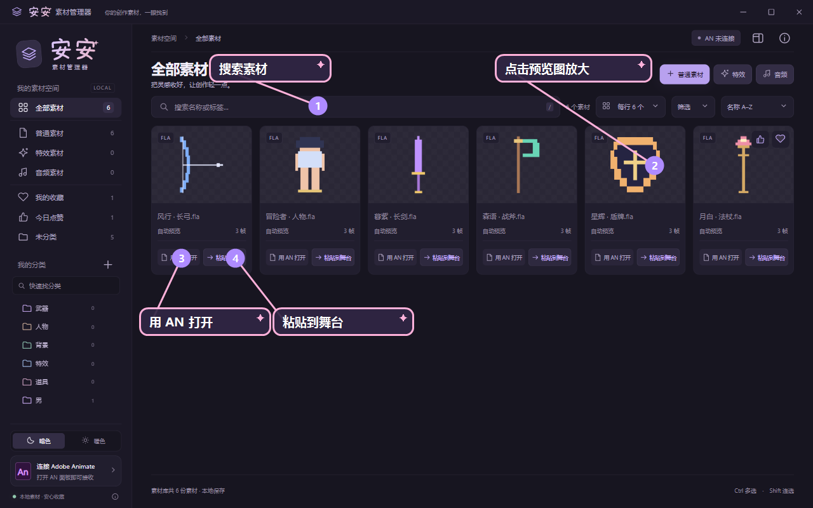
搜索框找素材；卡片底部可「用 AN 打开」或「粘贴到舞台」；右侧详情栏默认收起，网格空间更大。
### 2. 导入普通素材，并选择 2K 预览
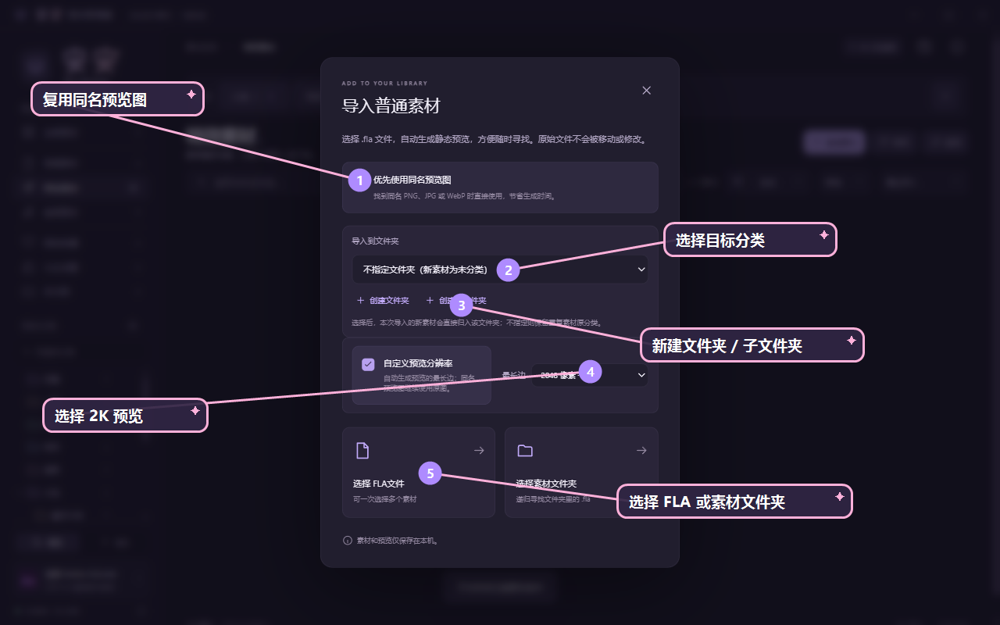
可以复用同名 PNG/JPG/WebP，也可以让管理器自动生成 256、512、1024 或 2048（2K）预览；导入时还能创建文件夹或子文件夹。
### 3. 从顶层分类进入更深的子分类
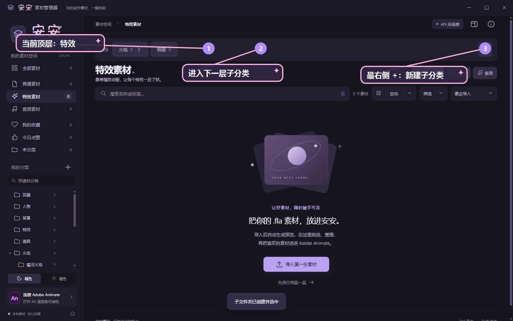
左侧先选顶层类型，例如「特效」；顶部再显示当前路径的下一层按钮。进入「都市人物」后，还能继续显示「男／女」等更深一级。
### 4. 只看当前文件夹直接归入的素材
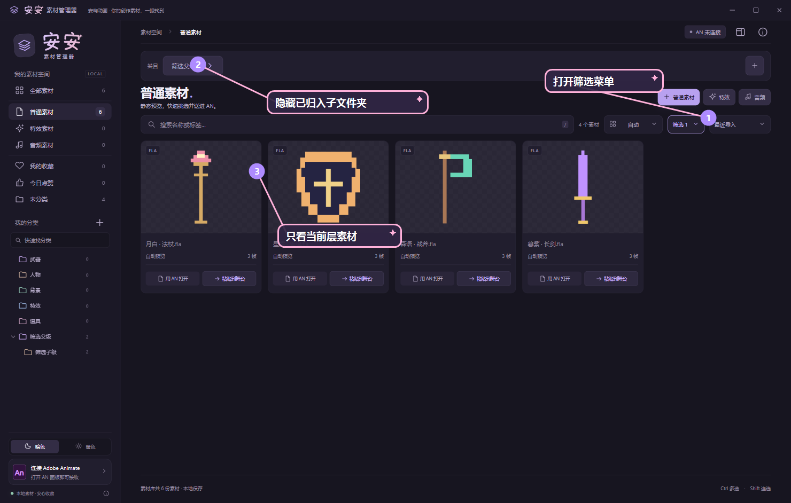
打开「筛选 → 隐藏已归入子文件夹」，快速整理当前层级，避免父文件夹和子文件夹的素材混在一起。
### 5. 收藏按原路径自动分组
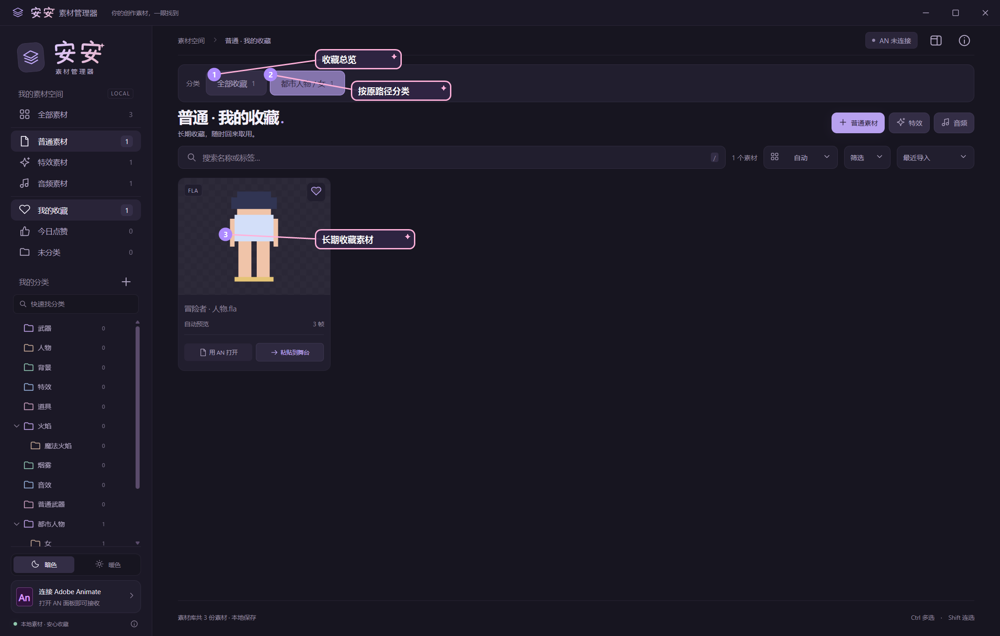
收藏长期保留，并沿用原来的分类路径；「今日点赞」只保留 24 小时，不建立额外分类树。
### 6. 点预览图放大，滚轮缩放
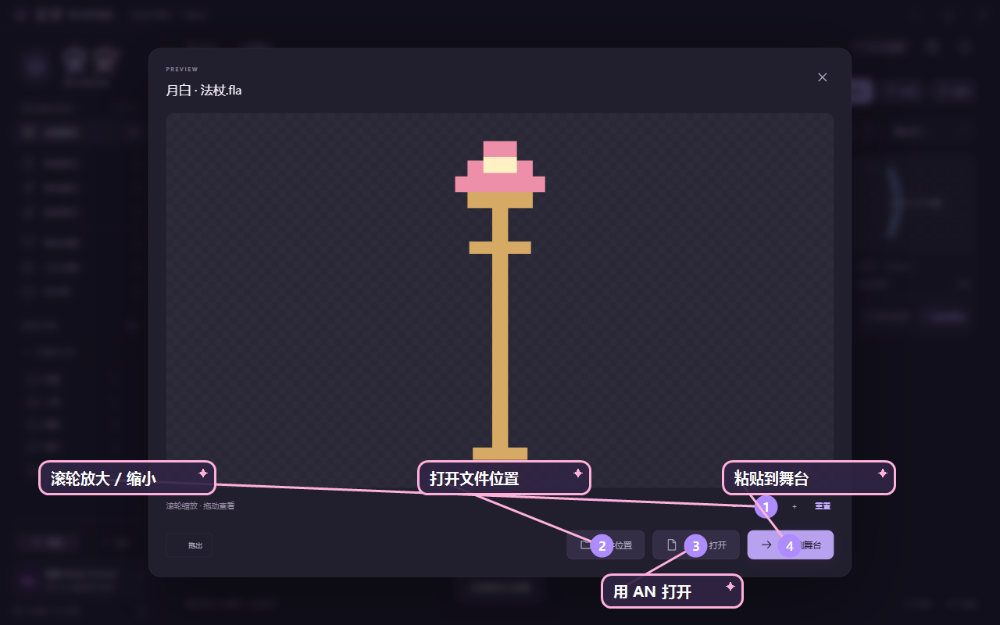
点任意预览图打开灯箱；鼠标滚轮缩放，拖动查看，底部可以打开文件位置、用 AN 打开或粘贴到舞台。
### 7. 特效素材单独导入并查看动图
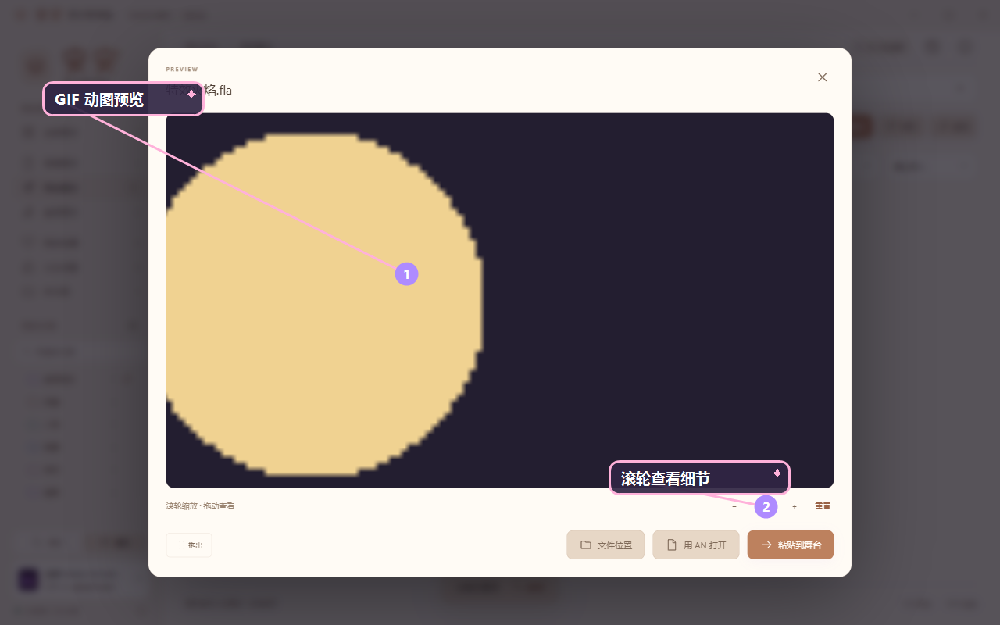
特效入口和普通素材分开，优先使用同名 GIF；没有 GIF 时自动生成受预算限制的动图预览，避免导入大文件时卡住普通素材库。
### 8. 音频库：试听、分类、拖出
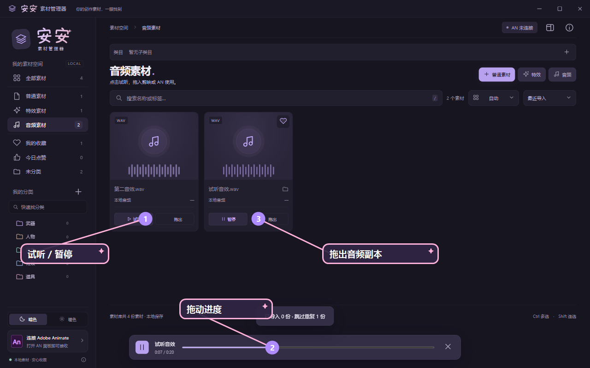
音频入口支持 MP3、WAV、OGG、FLAC；可以试听、搜索、收藏、分类，也可以拖出音频副本到支持导入的应用。
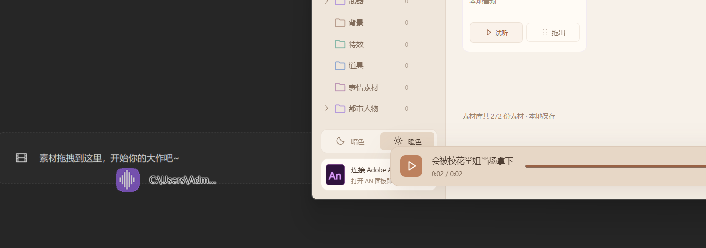
卡片按住「拖出」即可把音频副本拖到剪映等软件，原音频库文件不会被移动；底部播放器可以暂停和拖动进度。
### 9. 发送到 AN 当前舞台
打开目标 AN 文档和「安安素材管理器」面板：在管理器点击「粘贴到舞台」，再在 AN 面板点击同名按钮。素材会进入当前图层、当前播放头位置；没有关键帧时会在当前位置生成普通关键帧，不新建图层。
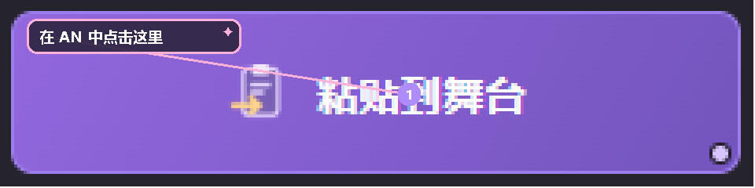
也支持把卡片拖到 AN 舞台；拖动到任务栏 AN 图标时，管理器会先切换窗口，再由面板确认目标文档。
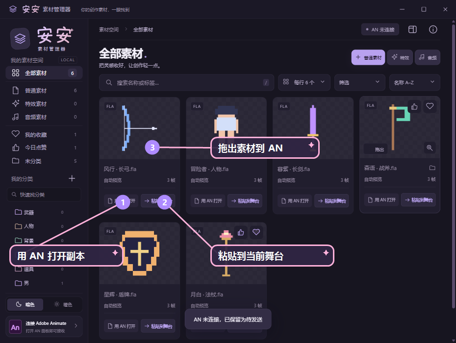
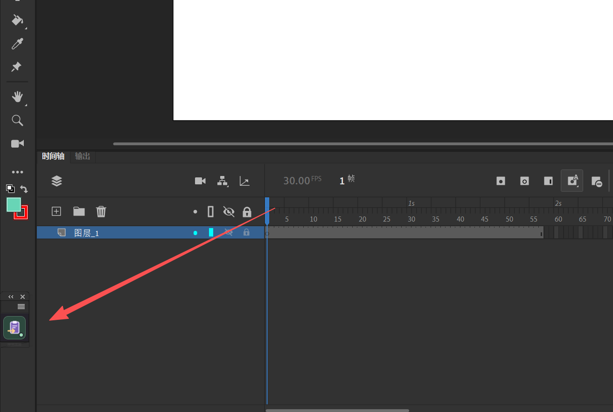
面板可以缩成侧边栏里的小按钮，不挡舞台；需要粘贴时点击该按钮即可回到当前 AN 文档处理。
### 10. 小窗和显示密度
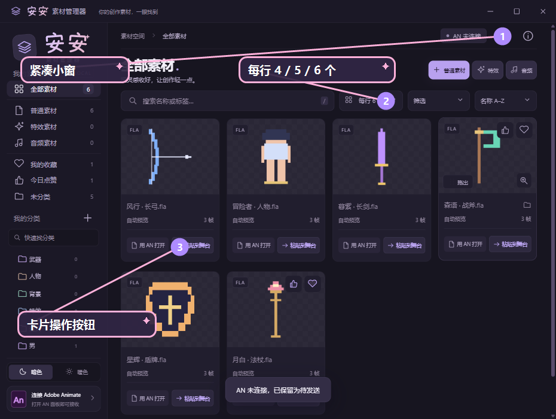
右上角小窗按钮用于和 AN 并排；显示菜单可选自动、每行 4、5 或 6 个素材。
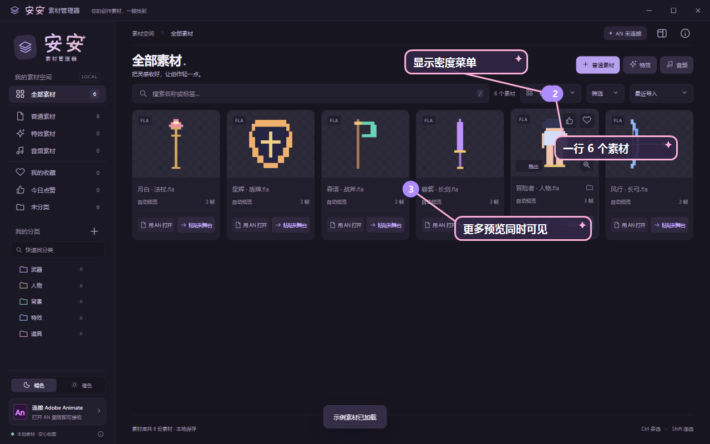
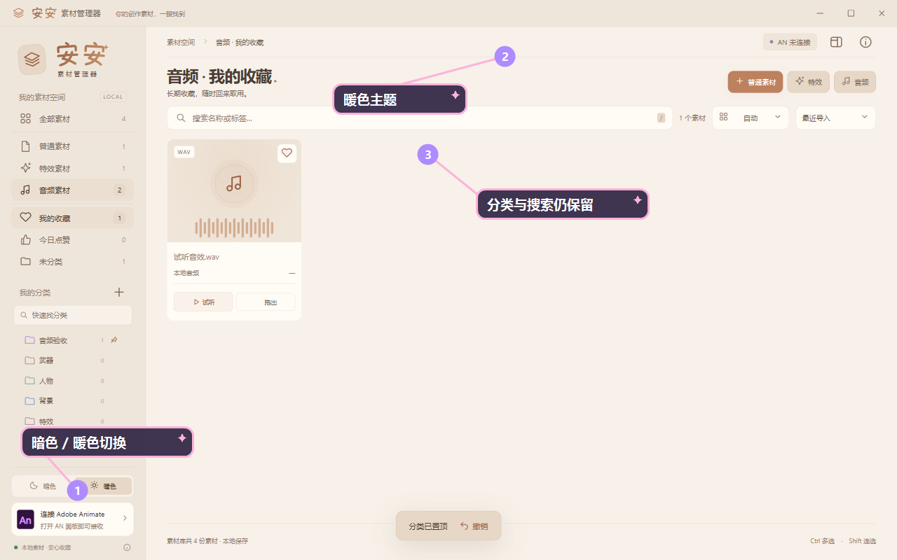
左下角可在暗色与暖色之间切换，偏好会自动记住。

## 功能亮点：它能替你省下什么

### 1. 先看预览图，再决定用哪个文件

- 导入 FLA 后自动生成静态预览；目录里已有同名 PNG、JPG、JPEG 或 WebP 时可以直接复用，不需要手动一张张截图。
- 预览最长边可选 256、512、1024 或 2048（2K）；小图不会被强行放大，原始 FLA 也不会被改写。
- 点击预览图进入灯箱，滚轮放大、拖动查看细节；还能一键打开原文件位置、用 AN 打开或粘贴到舞台。原文件找回不需要再翻文件夹。
- 搜索名称和标签即可快速定位；重复导入同一份内容会折叠成一条，素材库不会越导越乱。

### 2. 分类可以从少量文件一直长到大型素材库

- 普通素材、特效和音频各有独立入口；左侧管理顶层类别，顶部按钮显示当前路径的下一层，例如「都市人物 → 男／女」。
- 导入时可以直接选择已有文件夹，也可以创建顶级文件夹或子文件夹；新分类会立即成为导入目标。
- 分类支持置顶、折叠、搜索、批量移动和撤销；「隐藏已归入子文件夹」可以只看当前层，整理时不会被下层素材干扰。
- 收藏会按素材原来的分类路径自动生成分类按钮；点赞只保留 24 小时，适合临时收集当天要用的素材。

### 3. 普通素材、特效和音频各走适合自己的流程

- **普通素材**：适合人物、武器、背景等 FLA，优先使用已有预览，缺少预览时再生成静态图。
- **特效素材**：单独处理 GIF；优先复用同名 GIF，没有 GIF 才生成动图，并控制帧数、时长和像素预算，避免大特效拖慢普通素材库。
- **音频库**：支持 MP3、WAV、OGG、FLAC；卡片可以试听、暂停、拖动进度、收藏、分类，也能把音频副本直接拖到剪映等软件。

### 4. 选中的内容直接进入当前 AN 作品

- 「用 AN 打开」会打开库里的独立工作副本，方便查看和继续制作，不会误改素材库原件。
- 「粘贴到舞台」发送完整可编辑 FLA；在 AN 中点击面板按钮后，素材进入当前图层、当前播放头位置，大致位于舞台中央。
- 当前帧没有关键帧时，会在指针所在位置生成普通关键帧并保留当前内容；不会新建图层，也不会插入空白关键帧。
- 同一份素材有三种进入 AN 的方式：点击卡片「粘贴到舞台」的磁力式流程、把卡片拖到 AN 舞台、拖动时悬停任务栏 AN 图标后再释放；面板只有一个核心按钮，适合缩成侧边栏小面板。Animate 2023 已完成真实插入验证。

### 5. 界面跟着工作习惯走

- 右侧详情默认收起，把空间留给预览图；需要改名称、标签或分类时再展开。
- 暗色和暖色两套主题、自动或每行 4／5／6 个卡片、紧凑小窗和置顶模式，适合和 AN 并排工作。
- 卡片底部动作固定，鼠标悬停时才显示拖出、收藏、点赞和打开文件位置等辅助按钮，减少误点；临时要用的素材点一次点赞，24 小时内都能从「今日点赞」快速找回。

### 6. 本地优先，素材可控

- FLA、预览图、音频和索引默认只在本机处理，不要求上传素材到云端；原始文件位置和字节保持不变。
- 关闭管理器和 AN 后复制 `%APPDATA%\\AnShelf` 即可备份整个库；卸载软件不会主动删除素材库。
- 项目免费开源，代码采用 Apache-2.0；商业再发布按项目附加归属政策保留「安屿动画」归属，具体以 [NOTICE](NOTICE) 和 [COMMERCIAL-ATTRIBUTION.md](COMMERCIAL-ATTRIBUTION.md) 为准。

## 快速开始
1. 双击便携版 `安安素材管理器 0.3.2.exe`，或使用安装版桌面快捷方式。
2. 选择「普通素材」「特效素材」或「音频」，再选择文件或文件夹。
3. 在导入对话框选择已有分类，或新建顶级文件夹／子文件夹。
4. 用搜索、顶部子分类、收藏或筛选找到目标素材。
5. 点击「用 AN 打开」或「粘贴到舞台」；也可直接拖拽到 AN 舞台。
## 功能清单
| 模块 | 支持内容 |
| --- | --- |
| 普通素材 | FLA 导入、同名预览复用、自动静态预览、搜索、分类 |
| 特效素材 | FLA/GIF、动态预览、悬停播放、单独处理预算 |
| 音频库 | MP3/WAV/OGG/FLAC、试听、进度跳转、分类、拖出副本 |
| 分类 | 顶层文件夹、子文件夹、顶部逐层按钮、置顶、折叠、移动、撤销 |
| 整理 | 收藏、24 小时点赞、按原路径分组、隐藏子分类筛选 |
| AN 联动 | 当前图层/帧插入、完整 FLA、跨窗口拖拽、紧凑面板 |
| 界面 | 暗色/暖色、4/5/6 列、预览灯箱、滚轮缩放、紧凑小窗 |
## 常用说明
<details>
<summary>导入与预览规则</summary>
- 普通素材适合人物、武器、背景等 FLA；特效素材入口用于需要 GIF 预览的 FLA；音频入口只扫描 MP3、WAV、OGG、FLAC。
- 开启「优先使用同名预览图」时，例如 `长剑.fla` 同目录的 `长剑.png` 会直接复用；没有可用图片才自动渲染。
- 自动预览最长边支持 256、512、1024、2048（2K）；不会强行放大小图。
- 原始 FLA 和原始预览图不移动、不修改；管理器保存自己的副本和缓存。
</details>
<details>
<summary>分类、收藏与搜索</summary>
分类只写入库元数据，不移动原文件。选中素材后可批量选择分类；删除分类可撤销。收藏长期保留并按原路径生成顶部分类按钮；点赞 24 小时后自动退出点赞视图。
</details>
<details>
<summary>AN 插入规则与限制</summary>
素材插入当前图层、当前播放头位置，大致放在舞台中央；已有关键帧直接追加，没有关键帧时生成普通关键帧。不会自动保存目标作品，也不会新建目标图层。首次使用请用作品副本验证复杂骨骼、脚本、相机和多场景动画。
插件面板支持 Animate 2023/2024（CEP 11/12），Animate 2023 已在本机验证。若旧版面板空白，请关闭 AN，重新安装交付的已签名面板目录后再打开。
</details>
<details>
<summary>数据、性能和备份</summary>
素材库默认位于 `%APPDATA%\\AnShelf`，包括 `library.json`、`assets`、`previews` 和 `bridge`。关闭管理器与 AN 后复制整个文件夹即可备份。程序使用分页、预览缓存和低频空闲同步控制 CPU 与内存；具体占用随素材数量、动画播放和窗口状态变化。
</details>
## 开发与测试
需要 Node.js 22+、pnpm 和 Windows：
```powershell
pnpm install --frozen-lockfile
pnpm test
pnpm build
pnpm start
pnpm run package
```
UI 与导入验收脚本见 `scripts/`，测试说明见 [TEST_PLAN.md](TEST_PLAN.md)。发布前必须通过构建、自动测试、打包一致性检查，并由项目维护者确认后再上传公开仓库。
## 许可证与归属
项目代码采用 [Apache License 2.0](LICENSE)，并附带 [NOTICE](NOTICE) 与 [COMMERCIAL-ATTRIBUTION.md](COMMERCIAL-ATTRIBUTION.md)。个人、学习、研究和非商业创作可以免费使用，不要求额外页面署名；商业再发布或商业集成必须保留源代码归属、NOTICE，并在软件可见 UI 页面保留「安屿动画」。第三方组件许可证见 [THIRD_PARTY_NOTICES.md](THIRD_PARTY_NOTICES.md) 与 `vendor/licenses/`。
商业合同、大规模分发或特定国家／地区使用前，请让熟悉适用法域的律师审核最终文本。

## 给创作加一点光

如果安安素材管理器曾帮你更快找到素材、顺利完成一次创作，欢迎请作者喝一杯咖啡。

你的每一份支持，都会用于项目的持续维护、预览体验优化，以及更多实用功能的开发。

打赏完全自愿，不影响软件的免费下载、使用和开源许可。即使不打赏，也欢迎自由使用、提出建议，或把项目分享给需要的创作者。

感谢每一份鼓励，让这个小工具可以继续成长。

**支付宝**


**微信支付**


