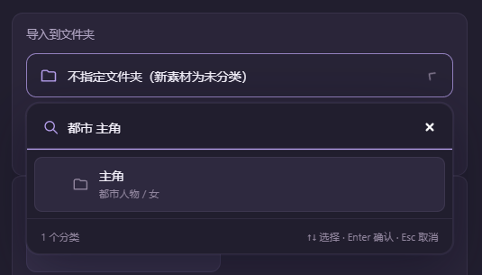
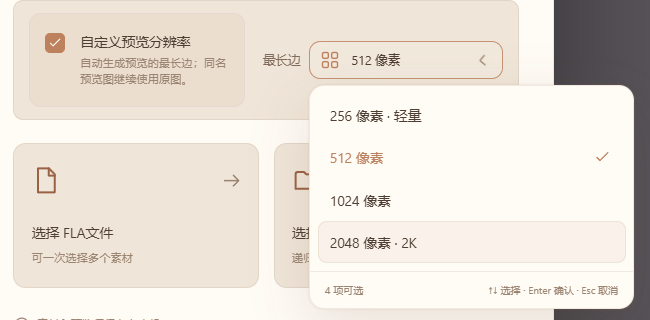
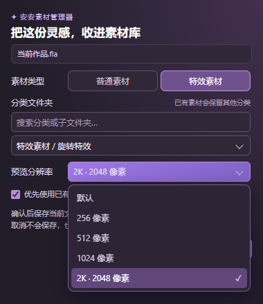

# 安安素材管理器 0.3.10

这次把「做一个素材变体」和「从 AN 收进素材库」两条流程补完整，也让分类多起来以后更容易选对位置。

## 下载与更新

安装版和免安装版二选一，原素材库继续沿用 `%APPDATA%\AnShelf`，无需重新导入。

| 中文入口 | 使用方式 |
| --- | --- |
| [安装版 0.3.10（推荐）](https://github.com/anyv-DH/anshelf/releases/download/v0.3.10/AnAn-AssetManager-Setup-0.3.10.exe) | 退出旧管理器后安装；按向导选择原安装位置 |
| [免安装版 0.3.10](https://github.com/anyv-DH/anshelf/releases/download/v0.3.10/AnAn-AssetManager-Portable-0.3.10.exe) | 放在固定目录，退出旧版后双击；旧快捷方式不会自动改指向 |
| [AN 插件备用包](https://github.com/anyv-DH/anshelf/releases/download/v0.3.10/AnAn-AssetManager-AnimatePlugin.zip) | 软件已附带，推荐在软件内安装；手动方式为完整解压后运行 `install.ps1` |
| [完整图文说明](https://github.com/anyv-DH/anshelf/releases/download/v0.3.10/AnAn-AssetManager-Usage.md) | 阅读全部导入、整理、预览及 AN 操作 |
| [文件校验信息](https://github.com/anyv-DH/anshelf/releases/download/v0.3.10/SHA256SUMS.txt) | 用于核对附件完整性，无需运行 |

**这次主程序和 AN 插件都升级到 0.3.10。**打开软件内「检查更新」或「连接 Adobe Animate」，点击「安装／更新 AN 插件」并确认；完成后关闭、重新打开 AN 面板，必要时先保存作品再自行重启 AN。只更新管理器、不更新面板，就不会看到新增的入库设置。软件不会自动保存、关闭或重启 AN。

## 复制成新素材，马上做另一个版本

在素材卡片名称旁点击双页图标，或从放大预览／详情点击「复制并入库」，确认后就会出现并选中一张新卡片，同时在资源管理器中定位该文件。

- 只新增一个库内 FLA／音频文件，并自动加入素材库；不再向外部原文件夹复制一份、重新导入又多出一份。
- 名称按「素材名 - 副本」自动递增，不覆盖已有文件。
- 继承原类型、全部分类、标签及预览设置；收藏和今日点赞重新开始。
- 原素材、副本和各自预览保持独立，可以分别打开修改、分类或移除；初始内容相同也不会误合并。
- 取消确认不创建文件，不改变原素材、索引和预览。写入失败会清理本次新文件。

普通批量导入继续折叠重复内容。普通打开、编辑、分类和舞台粘贴继续使用各素材自己的唯一管理文件，只有明确确认「复制并入库」才会制作独立副本。

## 五处选择菜单，都跟着主题走

主程序的导入分类、预览分辨率、上级分类、素材类型和详情移动分类，全部统一为暗色／暖色主题菜单。三处分类选择支持搜索和层级提示；分辨率与素材类型用紧凑列表，保持原有选项顺序。

输入分类名或父级路径即可筛选；子分类有层级提示，同名文件夹也能通过父路径区分。支持键盘选择、Esc 关闭和空结果提示。分类兼容规则保持有效，特效、普通素材和音频不会因为选择界面变化而串到不合适的目标中。

这只是让既有分类更好选，不会自动重排、移动或复制素材。

**找分类：**输入分类名或父级路径，结果同时展示子分类和父路径。

**选分辨率：**勾选「自定义预览分辨率」，再打开紧凑菜单选择最长边。

## AN 当前文档入库，保存前把选项选好

保持管理器运行，在 AN 小面板下方点加号「加入素材库」，确认当前文档后可设置：

| 选项 | 可选内容与规则 |
| --- | --- |
| 素材类型 | 普通素材／特效素材 |
| 分类文件夹 | 搜索并选择兼容分类；已有素材保留其他归属，不指定时保留原分类 |
| 自动预览分辨率 | 默认、256、512、1024、2048（2K） |
| 已有预览 | 可优先复用同名预览图；分辨率只影响自动生成的预览 |

AN 入库窗口里的分类和分辨率也采用紫色主题菜单，分类仍可搜索，不再弹出系统样式的原生列表。

图为隔离演示界面，用于说明选项与位置，不代表完整实际 AN 宿主流程已经验收。

点击「保存并加入」后才保存当前文档并提交入库；取消不会保存或导入。未命名文档继续使用 AN 自带保存窗口，取消保存就停止。确认期间切换文档会中止，避免保存错作品。

库内已有文档更新原记录与预览，不额外复制 FLA；外部新作品沿用正常导入方式。旧请求未携带新选项时继续使用原默认行为，已有分类、类型和设置不会被无意清空。

### 面板仍然可以缩得很小

面板延续约 48×88、最低 40×80 的两个竖排按钮：上方粘贴到舞台，下方加入素材库。窄浮窗会尝试临时展开设置，完成后恢复。

**AN 停靠栏如果不允许展开，仍使用原生确认和旧默认入库方式，原生窗口不显示新选项。**需要完整选择时，先把面板拉出为浮窗，或在管理器中导入。最终标题栏和停靠尺寸由 AN 控制。

## 数据与兼容边界

- 分类是元数据；「加入其他分类」继续共享同一份素材。制作独立变体请使用明确的复制入口。
- 外部最初导入文件不改动。通过「用 AN 打开」修改的是素材库中该素材自己的管理文件；请在 AN 中保存后再重新使用。
- 历史 Animate 2023 基本粘贴已有记录；**0.3.10 更新后的完整实际宿主流程、任务栏悬停和 Animate 2024 仍需独立验证**。浏览器或 VM 测试不能替代真实宿主。
- 复杂脚本、相机、骨骼、字体和特殊动画的自动预览可能与 AN 不完全一致，预览用于选材参考。

项目继续免费开源。如果它让您少翻几次文件夹、多留一点时间给创作，欢迎到 [GitHub 项目](https://github.com/anyv-DH/anshelf) 点一颗 Star。谢谢每位使用、反馈和分享的创作者。
